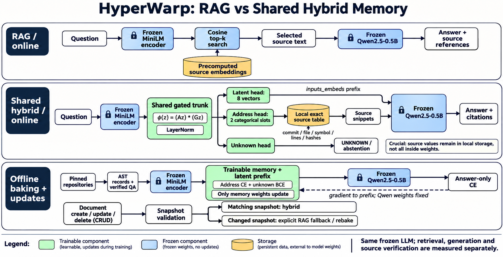
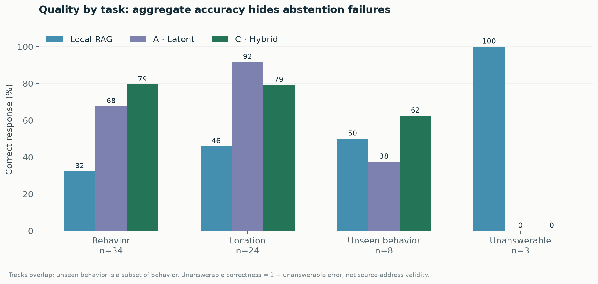

# HyperWarp

Local codebase memory: a shared latent/address hybrid on frozen Qwen, with versioned document CRUD and verifiable source references.

## Run

Python 3.12 recommended. Install CUDA-enabled PyTorch for GPU inference, then:

```powershell
python -m venv .venv
.venv\Scripts\python -m pip install -r requirements.txt
# Optional: share an existing Hugging Face cache.
$env:SVAI_MODEL_CACHE = 'C:\path\to\huggingface-cache'
.venv\Scripts\python -m uvicorn svai.app:app --host 127.0.0.1 --port 8011
```

Open [workspace](http://127.0.0.1:8011/) or [API documentation](http://127.0.0.1:8011/docs).

`SVAI_DB` overrides the SQLite database path. `SVAI_DEVICE` accepts `auto`, `cuda`, or `cpu`. Models load lazily, or through `POST /api/model/load`. Base models are Qwen/Qwen2.5-0.5B-Instruct and sentence-transformers/all-MiniLM-L6-v2.

## Sources and hybrid checkpoint

`python -m svai.bootstrap --help` shows pinned public-repository import options. `python -m svai.import_codebases --help` imports existing AST source indices. Both produce portable source records in SQLite.

The default request mode is `hybrid`. A trusted, locally trained checkpoint belongs at `data/checkpoints/hybrid.pt`, or set `SVAI_HYBRID_CHECKPOINT`. Weights, models and databases are excluded from Git. The local demo has its trained checkpoint installed; a fresh clone needs a checkpoint before the hybrid executes. Without a matching checkpoint the response explicitly reports `actual_mode: rag` and `fallback_reason`.

Hybrid uses one shared trained trunk, eight latent prefix vectors, two categorical address slots and an unknown head. Current-source hashes must match the baked snapshot. Creating, modifying or removing records can invalidate the snapshot; live RAG remains available while a new memory is prepared. Automatic background retraining is not implemented.

## API

| Route | Purpose |
|---|---|
| `GET /api/health` | Service and corpus state |
| `GET /api/model/status` | Frozen models and hybrid readiness |
| `POST /api/model/load` | Load local Qwen and MiniLM |
| `GET /api/repositories` | Available sources |
| `POST /api/documents` | Create a document |
| `GET /api/documents` | Filtered, paginated listing |
| `GET /api/documents/{id}` | Read content and metadata |
| `PUT /api/documents/{id}` | Update, optionally checking `expected_version` |
| `DELETE /api/documents/{id}` | Delete and invalidate cached retrieval |
| `POST /api/search` | Retrieve source evidence |
| `POST /api/query` | Answer with hybrid, RAG or evidence mode |
| `GET /api/citations/{id}` | Inspect source identity and provenance |

Example request:

```json
{
  "question": "How does Signer.validate handle an invalid signature?",
  "repositories": ["itsdangerous"],
  "mode": "hybrid",
  "use_ml": true,
  "top_k": 2
}
```

Responses report the actual execution mode, selected source records, versions, content hashes and pinned source links. A citation identity check does not establish semantic correctness of the answer.

## Results and verification

The code-trained hybrid scored **46/61 exact answers (75.4%)** across a source-grounded QA sample; Django contributed **17/21** correct answers. Eight behavior intents were held out of training/dev; hybrid answered five correctly. Unknown questions remain a weakness: all three were answered incorrectly in the offline benchmark.

This measures a QA sample against 12,244 source candidates, not all possible questions about these repositories. Full result files and graphical breakdowns are under [`docs/results`](docs/results) and [`docs/visuals`](docs/visuals). The offline RAG baseline uses dense cosine retrieval; the live API uses dense + BM25, so those scores should not be conflated.

Additional executed upstream checks: ItsDangerous 297 passed; HTTPX model/config/status tests 865 passed; Django utilities 717 ran, 49 skipped, no failures. These are selected upstream suites, not the complete Django or HTTPX test suites.

Backend tests cover CRUD, persistence, optimistic version conflicts, retrieval refresh and source-snapshot staleness. See `tests/` for runnable checks. No API authentication or production deployment hardening is claimed by this local MVP.

## Architecture

See [`docs/ARCHITECTURE.md`](docs/ARCHITECTURE.md) for model dimensions, training, the gradient path and exact Mermaid diagrams.




