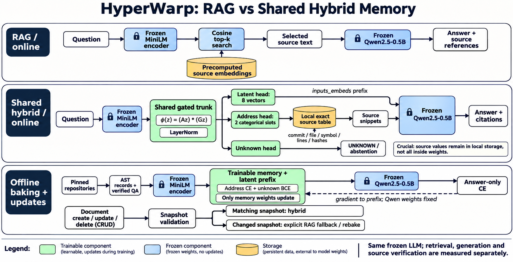
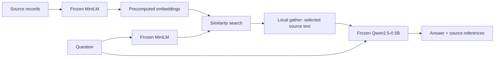
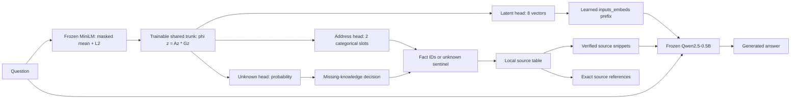
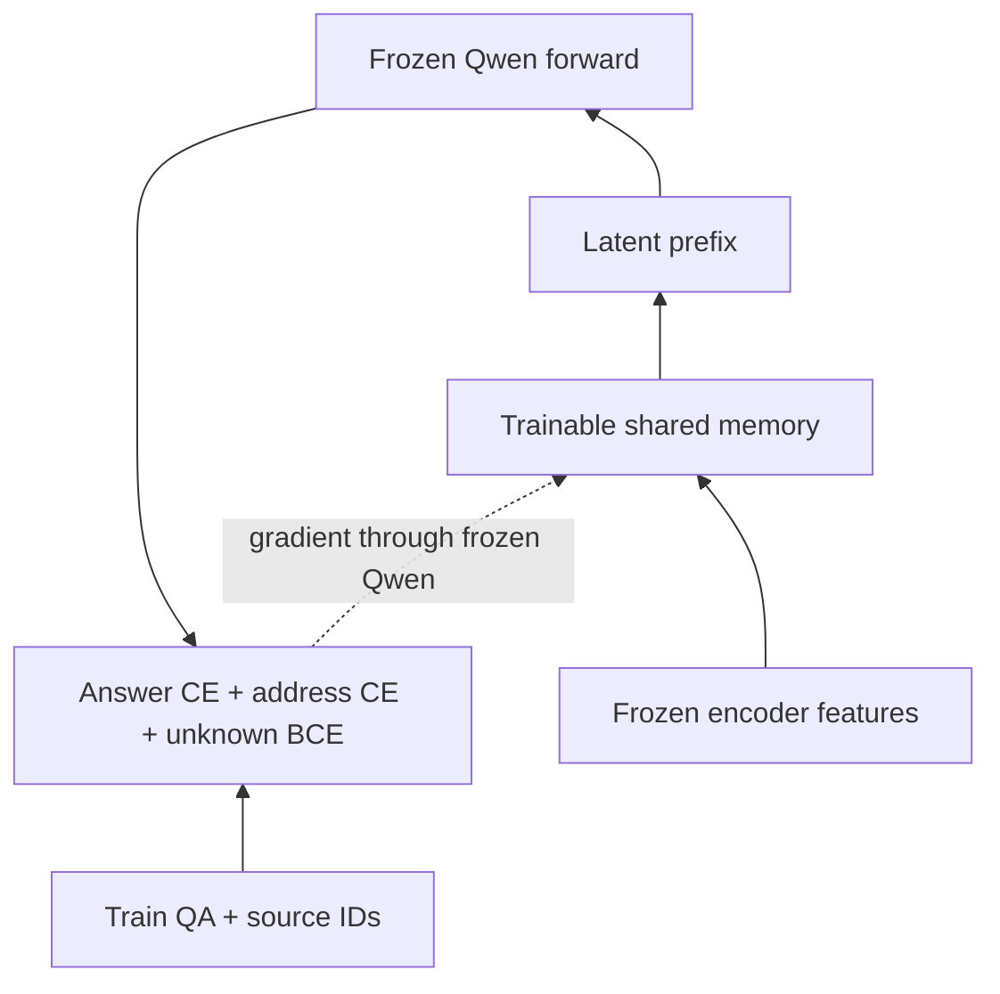
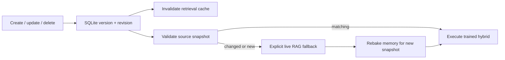
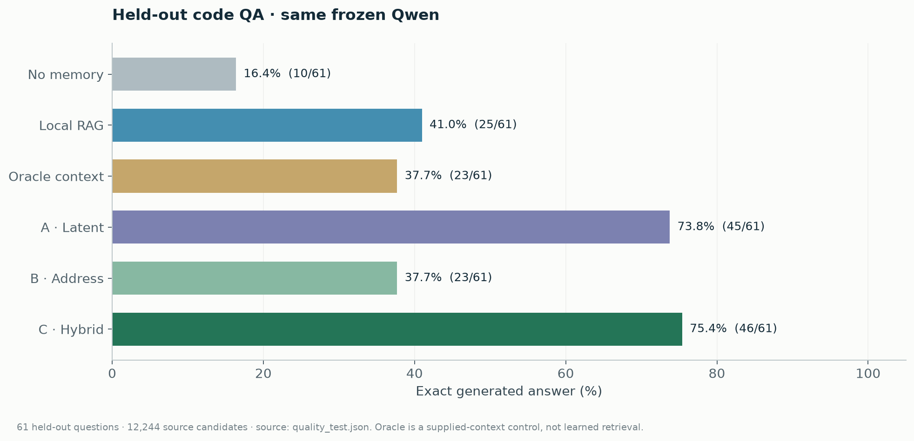
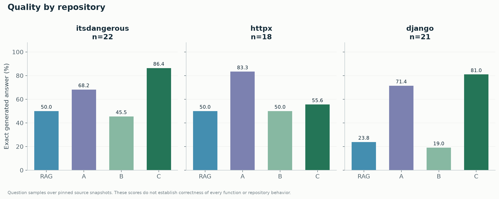
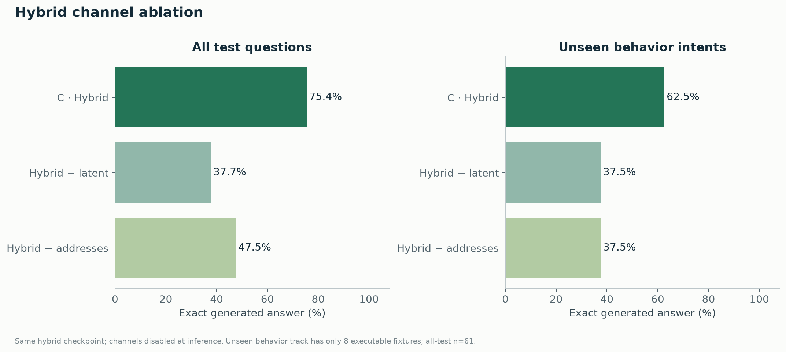
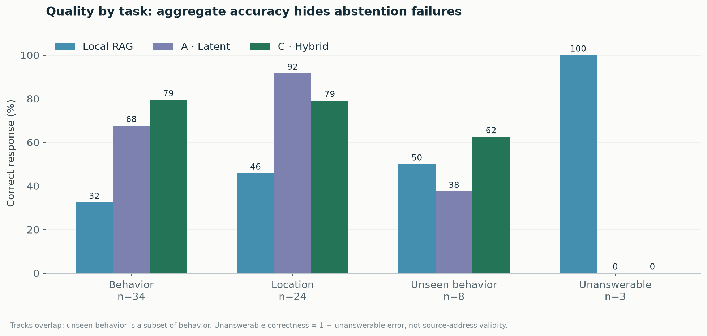
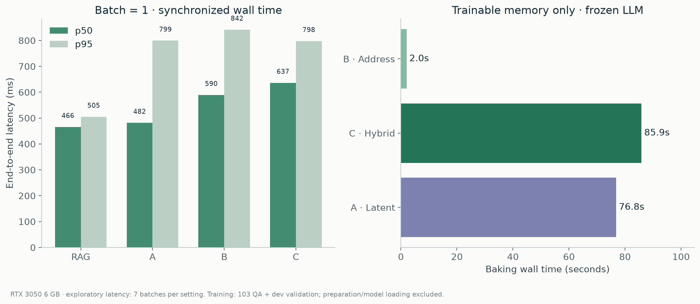

# HyperWarp: как работает RAG и shared hybrid memory

HyperWarp подаёт одной замороженной Qwen два вида информации: **что нужно учесть** и **какой исходник нужно прочитать**. Первый канал обучается как компактный prefix, второй выбирает адреса записей. Источники остаются в локальном хранилище и возвращаются вместе с ответом.



Точная схема ниже соответствует коду; AI-иллюстрация — визуальное объяснение этой схемы.

## 1. Обычный RAG

На подготовке мы разбиваем репозиторий на записи функций и классов. У каждой записи есть текст, qualified symbol, commit, путь, строки и хеши. Замороженный MiniLM превращает текст в вектор, который сохраняется для поиска.

На запросе тот же encoder превращает вопрос в вектор. Поиск выбирает top-k записей; их текст добавляется в prompt Qwen. Qwen читает этот контекст и генерирует ответ.



**Две реализации нужно различать:** исследовательская таблица `experiments/code` использует dense cosine retrieval, top-k и threshold выбираются на dev. В live API дополнительно используется BM25 и смешивание dense/lexical scores. Поэтому offline RAG-число нельзя выдавать за измерение качества live API без отдельного прогона.

## 2. Что меняет гибрид

После encoder стоит небольшой обучаемый модуль. Он делает один forward и сразу выдаёт три результата.



### Encoder

MiniLM даёт вектор вопроса размерности 384. Padding исключён из mean pooling, затем применяется L2 normalization. Encoder не обучается в этом эксперименте. Его признаки train/dev кешируются; в benchmark признаки запросов пересчитываются.

### Shared trunk

Вход нормализуется LayerNorm. Две линейные проекции умножаются поэлементно:

`h = (A · z) ⊙ (G · z)`

Далее идут residual MLP-блоки и выходная нормализация. Это нелинейная ассоциативная память: сочетания признаков вопроса влияют на выбор источников и на latent prefix. В текущем конфиге hidden=192, depth=2.

### Латентный канал

Одна линейная голова превращает общий hidden state в восемь векторов пространства embeddings Qwen. Эти векторы вставляются перед prompt через `inputs_embeds`. Это не восемь сгенерированных слов: память сразу выдаёт все восемь числовых векторов за один проход.

Prefix помогает Qwen преобразовать найденное знание в нужный ответ. Сам по себе prefix не является цитатой или доказательством.

### Адресный канал

Голова выдаёт два набора logits по `N + 1` классам: N записей и специальный unknown sentinel. Вопрос может требовать два supporting facts. После выбора ID выполняется обычное локальное чтение таблицы.

Адрес имеет структуру `repository → commit → file → qualified symbol → line range → fragment hash`. Нейросеть выбирает запись, а не сочиняет имя файла или номер строки. **Правильная ссылка и правильный выбор ссылки — разные проверки.** Хеш подтверждает идентичность текста, а supporting-fact precision/recall оценивают выбор.

Для `N=12,244` здесь используется обычная categorical head. Это не O(1)-магия: выходное отображение всё ещё выдаёт N scores на слот. SECDED/code head реализована отдельно и не используется как основной live hybrid.

### Unknown

Отдельная голова оценивает отсутствие достаточных данных. Её порог выбирается на dev. Это обученный сигнал, а не доказательство отсутствия ответа. В сохранённом offline-прогоне hybrid ошибся на всех трёх unanswerable вопросах; эту ошибку нужно видеть отдельно от средней accuracy. Live adapter дополнительно ограничивает адреса текущим разрешённым набором документов и возвращает UNKNOWN при отсутствии выбранных источников.

## 3. Как обучается память

Есть размеченная тройка: вопрос, правильный короткий ответ и IDs supporting fragments. Qwen и MiniLM frozen. Обучаются shared trunk и три головы.

`L = L_answer + alpha · L_address + beta · L_unknown`

- `L_answer`: causal cross-entropy только по токенам ответа, не по prompt/padding/prefix.
- `L_address`: cross-entropy правильных адресов в двух слотах; свободные слоты заполнены unknown sentinel.
- `L_unknown`: binary cross-entropy answerable/unanswerable.

Сначала адресная голова разогревается на кешированных encoder features. Затем идёт совместное обучение; Qwen получает предсказанные адреса, не подставленные oracle IDs. Параметры Qwen не меняются, но autograd проходит через её вычисления к prefix. Поэтому training forward нельзя оборачивать в `no_grad`.



Current run: train=103, dev=53, test=61. Есть 34 исполняемых поведенческих сценария; восемь behavior intents отсутствуют в train/dev. Корпус исходников общий: проверяются новые вопросы к известному snapshot, а не перенос на неизвестный репозиторий. Open-source pretraining exposure у базовых моделей не исключалась.

## 4. Что происходит после CRUD

SQLite хранит content, version, metadata и SHA-256. Create/update/delete увеличивает revision; retrieval caches привязаны к revision и версии документа. Optimistic `expected_version` защищает от потерянного параллельного обновления.

Перед hybrid-запросом adapter сопоставляет записи checkpoint с текущими источниками по commit, пути, символу, строкам, fragment hash и content hash. Несовпадение или новый документ означает необходимость rebake. API явно отвечает `actual_mode=rag` и `fallback_reason`, если trained snapshot не подходит. Название requested mode не маскирует фактически исполненный путь.



## 5. Что измерено







Гибрид дал **46/61 = 75.4%** exact generated answers; latent-only A — **45/61 = 73.8%**, dense RAG — **25/61 = 41.0%**. По Django у гибрида **17/21 = 81.0%**. На восьми unseen behavior intents — **5/8 = 62.5%**. Это QA-выборка поверх большой таблицы кандидатов; она не доказывает правильность всех функций Django.

Oracle получает правильные supporting IDs и проверяет влияние качества контекста. Он не является самостоятельным поиском. Его generated EM может быть ниже hybrid: prefix дополнительно обучается отвечать в нужном формате, а frozen Qwen с одним oracle context этого обучения не получает.

Обучение памяти на RTX 3050 6 GB: B — 2.0 s, C — 85.9 s, A — 76.8 s. Сумма 164.7 s не включает подготовку данных, загрузку моделей и финальную оценку. Latency-график берёт сохранённые синхронизированные wall-clock замеры, по семь batch samples; эти percentiles exploratory.

## 6. Как воспроизвести графики

В корне исследовательского workspace:

```powershell
.venv-memory/Scripts/python.exe docs/visuals/generate_charts.py <path-to-experiments/code>
```

В `visuals/chart_data.json` сохранены исходные метрики, а каждый график доступен в PNG и SVG. PNG удобно показывать, SVG удобно редактировать и масштабировать. AI-диаграмма не используется для численных графиков.
